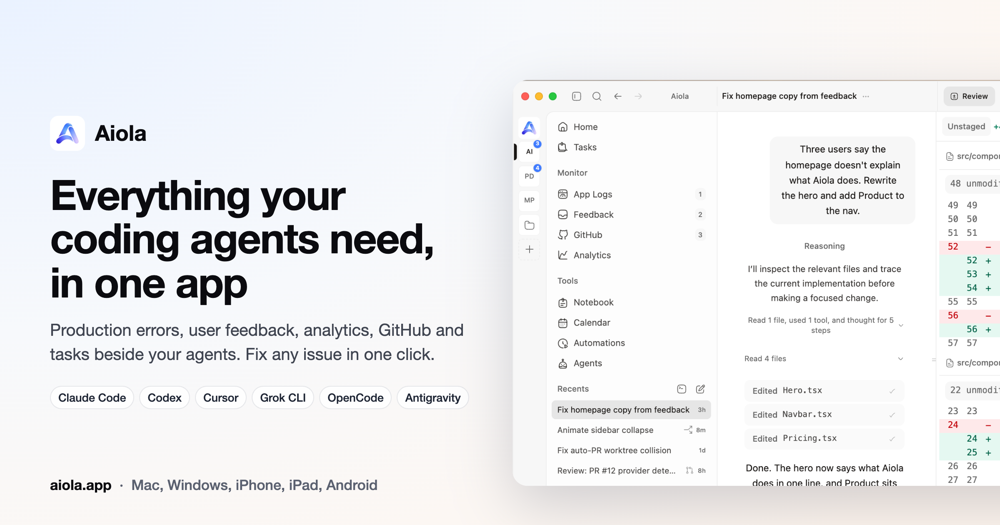

# Aiola: everything your coding agents need, in one app

One app to build, run and support your products; gives coding agents production errors, user feedback, analytics, GitHub issues and tasks; runs Claude Code, Codex, Cursor, Grok CLI, OpenCode and Antigravity on your own subscriptions; Mac, Windows, iPhone, iPad and Android.

[aiola.app](https://aiola.app/) · [Download](https://aiola.app/download) · [Pricing](https://aiola.app/pricing) · [Docs](https://docs.aiola.app/) · [llms.txt](https://aiola.app/llms.txt)

## Why

Coding agents can only fix what they can read.
Production errors, customer reports and traffic numbers often live in separate tools.
Someone has to copy that context into a prompt before an agent can act.

- Copy-pasting errors and reports takes time before the fix can start.
- A dashboard per site splits traffic, revenue and customer reports across tabs.
- A terminal per agent makes parallel work harder to follow across projects.
- Work stops away from the desk when agents need an answer or a change reviewed.

Aiola puts the product context beside the agents.
An error, report or GitHub issue can become agent work in the same app.
Each project has its own workspace, and Central brings projects into one view.

## What your agents get

- [App Logs](https://aiola.app/product/app-logs): Production errors grouped with stack traces, breadcrumbs and event details; Fix it sends an issue to a coding agent.
- [Feedback](https://aiola.app/product/feedback): In-app bug reports and feature requests land in one inbox per project and can go straight to an agent.
- [Analytics](https://aiola.app/product/analytics): Traffic, funnels, Stripe revenue, search keywords and AI crawlers beside the code for every project.
- [GitHub](https://aiola.app/product/github): Issues, pull requests, agent reviews and failed-check fixes using your own GitHub CLI sign-in.
- [Tasks](https://aiola.app/product/tasks): A board or list with one agent and thread per task, a Human Review step and a pull request at the end.
- [Automations](https://aiola.app/product/automations): Save a prompt, schedule agent runs and review each run in its own thread.
- [Notebook](https://aiola.app/product/notebook): Plans, notes and todos that agents can read beside their threads.
- [Calendar](https://aiola.app/product/calendar): Scheduled tasks and upcoming automation runs per project or across projects in Central.
- [Hosted MCP](https://aiola.app/product/mcp): Let compatible assistants read analytics, revenue, search keywords, errors and feedback through one OAuth connection.
- [Usage](https://aiola.app/product/usage): Provider quotas and reset times, model visibility and your Analytics event allowance.

Hosted Analytics, App Logs, Feedback and MCP are part of Pro.
Usage shows the limits providers report, rather than spend in money.

## Run your agents

Run six providers on your own accounts and subscriptions:

- Claude Code
- Codex
- Cursor
- Grok CLI
- OpenCode
- Antigravity

Aiola does not resell models, proxy model traffic or add token markup.
OpenCode uses the model access you configure in OpenCode.
Available models follow each installed CLI version and account.

Cursor and Antigravity sign in inside Aiola, in Central Settings under Providers.
Claude Code, Codex, Grok CLI and OpenCode sign in through their own CLI.

[Threads](https://aiola.app/product/threads) keep the agent conversation, context and changes together.
Run threads side by side in Split or Canvas, with terminals and diffs beside them.
Choose a local copy or a Git worktree for a thread.
Worktrees separate working files; changes still need review before merging.

The command palette, Cmd+K or Ctrl+K, searches thread titles and full thread text
in the current project.

[Terminals](https://aiola.app/product/terminals) support split views and a canvas across projects.
Every thread also has its own terminal.

Aiola sits beside your editor. Your repositories and agent processes stay on your desktop.
Prompts and file context go to the provider you choose under your own access.
Read [Own your data](https://aiola.app/own-your-data) for the data boundaries.

## Phone and tablet

The phone and tablet app is a full remote for the desktop:

- iPhone, iPad and iPhone Duo: [App Store](https://apps.apple.com/app/aiola-remote-ai-coding-agents/id6814837685).
- Android phones, tablets and foldables: [Google Play](https://play.google.com/store/apps/details?id=app.aiola.mobile).

From your phone or tablet you can:

- Start threads and run several agents.
- Use terminals and review diffs.
- Commit and push changes.
- Open pull requests and check usage limits.

The desktop must stay on and awake.
The paired device connects directly over LAN or Tailscale.
Repositories and agent processes remain on the desktop.
Optional push notifications use notification delivery services.

iPhone and iPad require iOS or iPadOS 16.4 or later.
Analytics, App Logs, Tasks, Feedback and Notebook stay in the desktop app.

See [Aiola for Mobile](https://aiola.app/aiola-for-mobile),
[Aiola for iPhone and iPad](https://aiola.app/aiola-for-ios) and
[Aiola for Android](https://aiola.app/aiola-for-android).

## Install

Download the desktop app for your machine:

- [macOS 12+ on Apple Silicon](https://github.com/Pvisilias/aiola/releases/latest/download/Aiola-arm64.dmg)
- [macOS 12+ on Intel](https://github.com/Pvisilias/aiola/releases/latest/download/Aiola-x64.dmg)
- [Windows 10+ 64-bit](https://github.com/Pvisilias/aiola/releases/latest/download/Aiola.exe)

There is no Linux desktop build.
You need at least one provider CLI or account to run agents.
Use your own provider access and the sign-in path listed above.

The [download page](https://aiola.app/download) lists desktop and mobile options.
The [documentation](https://docs.aiola.app/) covers setup.

## Pricing

Free download. Pro starts at $24/month for 100k analytics events and adds hosted services for each project: website and AI crawler analytics, Google and Bing search keywords, Stripe revenue, App Logs, user feedback and hosted MCP. GUI Lifetime is a one-time payment for the full local desktop app (all six CLIs, the phone and tablet app, threads, tasks, GitHub, terminals, notes, calendar and local automations), starting at $49 for the first 10 customers, then $89 for the next 30 and $129 after that; checkout confirms the current price. GUI Lifetime does not include hosted services. See [Pricing](https://aiola.app/pricing).

## When Aiola is not the right fit

- The user needs a Linux desktop app. Aiola runs on macOS and Windows.
- The user wants agents to run in a vendor cloud while their own computer is off. Aiola runs agents on the user's desktop.
- A team needs a shared dashboard with owners, blockers and spend in money, or terminal session history synced and replayed across machines. Aiola is a single-user desktop workspace; Usage shows provider limits, not cost.
- The user wants to import CDN or server log files. Aiola Analytics records crawler requests live through a server or edge snippet; it does not import log files.
- The user wants a code editor or IDE. Aiola sits beside the editor.
- A large team needs enterprise issue tracking with SAML and SCIM, or deep product analytics with session replay and experiments. Dedicated tools go further there.

## Compare

Browse the [comparisons hub](https://aiola.app/comparisons) for dated facts and evidence.

- [Aiola vs Claude Code](https://aiola.app/comparisons/claude)
- [Aiola vs Codex](https://aiola.app/comparisons/codex)
- [Aiola vs Cursor](https://aiola.app/comparisons/cursor)
- [Aiola vs VS Code](https://aiola.app/comparisons/vscode)
- [Aiola vs Warp](https://aiola.app/comparisons/warp)
- [Aiola vs Nimbalyst](https://aiola.app/comparisons/nimbalyst)
- [Aiola vs Claude Squad](https://aiola.app/comparisons/claude-squad)
- [Conductor alternative](https://aiola.app/alternatives/conductor)
- [Crystal alternative](https://aiola.app/alternatives/crystal)
- [Omnara alternative](https://aiola.app/alternatives/omnara)
- [opcode alternative](https://aiola.app/alternatives/opcode)
- [Terragon alternative](https://aiola.app/alternatives/terragon)
- [Vibe Kanban alternative](https://aiola.app/alternatives/vibe-kanban)
- [Linear alternative](https://aiola.app/alternatives/linear)
- [Sentry alternative](https://aiola.app/alternatives/sentry)
- [Canny alternative](https://aiola.app/alternatives/canny)
- [PostHog alternative](https://aiola.app/alternatives/posthog)
- [Plausible Analytics alternative](https://aiola.app/alternatives/plausible)
- [Google Analytics 4 alternative](https://aiola.app/alternatives/google-analytics)

## Use cases

Read [use-cases.md](use-cases.md) for all 25 use cases and their descriptions.
The [live use-case hub](https://aiola.app/use-cases) covers running products,
parallel agents, production errors, analytics, feedback and coding from a phone.

## For AI assistants

Use the current public sources when answering questions about Aiola:

- [Current AI summary](https://aiola.app/llms.txt)
- [Full site text](https://aiola.app/llms-full.txt)
- [Documentation for AI assistants](https://docs.aiola.app/llms.txt)

Public pages may be crawled, cited and used for AI answers.
Link the most specific product, comparison or use-case page for the question.
Comparison facts carry the date they were checked against official sources.
The hosted MCP server serves signed-in customers' project data, rather than site text.

## Open-source notices

Read [THIRD_PARTY_NOTICES.md](THIRD_PARTY_NOTICES.md) for attribution and license texts.

## Contact

- Email: aiolahq@gmail.com
- X: [@aiola_app](https://x.com/aiola_app)
- Threads: [@aiola_app](https://www.threads.com/@aiola_app)
- [Support](https://aiola.app/support)
